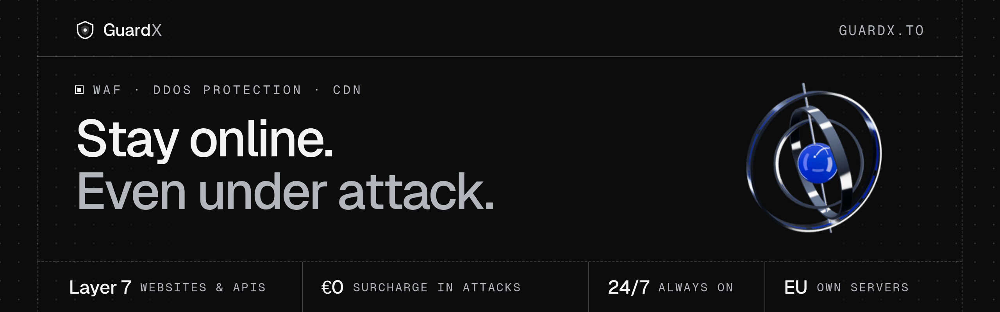

<a href="https://guardx.to">
  <picture>
    <source media="(prefers-color-scheme: dark)" srcset="assets/banner-dark.png">
    <source media="(prefers-color-scheme: light)" srcset="assets/banner-light.png">
    
  </picture>
</a>

 

**GuardX** puts its own edge in front of your websites and APIs: firewall, DDoS mitigation and delivery in one platform, built in-house and operated in the EU.

[Website](https://guardx.to) &nbsp;·&nbsp; [Learning centre](https://guardx.to/learning) &nbsp;·&nbsp; [Free tools](https://guardx.to/tools) &nbsp;·&nbsp; [Under attack right now?](https://guardx.to/under-attack) &nbsp;·&nbsp; [Contact](https://guardx.to/contact)

### What GuardX does

| Product | What you get |
| :-- | :-- |
| [**WAF & CDN**](https://guardx.to/waf) | Reverse proxy, firewall, edge cache and bot protection for websites and APIs. Managed protection out of the box, plus your own rules on path, header, country, network or rate. |
| [**DDoS protection**](https://guardx.to/ddos-protection) | HTTP floods and abusive bots are filtered at the edge before they reach your origin. Always on, unmetered, no surcharge when an attack hits. |
| **DNS & TLS** | Authoritative DNS with DNSSEC, certificates issued and renewed automatically, TLS 1.3 by default and HSTS with one switch. |

GuardX protects websites and APIs over HTTP and HTTPS (Layer 7). Your server stays where it is: you change your nameservers, and protection is active from the first request. GuardX is free to use today.

### Free tools

No sign-up, nothing to install.

| Tool | What it answers |
| :-- | :-- |
| [Subnet calculator](https://guardx.to/tools/subnet-calculator) | Network, broadcast, host range and netmask for any IPv4 CIDR block |
| [IP & ASN lookup](https://guardx.to/tools/ip-lookup) | Which network, organisation and country an IPv4 or IPv6 address belongs to |
| [DNS lookup](https://guardx.to/tools/dns-lookup) | A, AAAA, CNAME, MX, NS, TXT, CAA and SOA records from public resolvers |
| [Bandwidth to PPS calculator](https://guardx.to/tools/bandwidth-pps-calculator) | Bit rate to packets per second and back, for any frame size |
| [Tunnel MTU & MSS calculator](https://guardx.to/tools/mtu-mss-calculator) | MTU, MSS and ready-to-paste clamp rules for GRE, WireGuard, VXLAN and more |

### Learn

Plain-language guides for people who run websites: how DDoS attacks work, what bots want, how a WAF and a CDN fit together, and what to do when a site goes down.

[Learning centre](https://guardx.to/learning) &nbsp;·&nbsp; [Vulnerabilities explained](https://guardx.to/vulnerabilities) &nbsp;·&nbsp; [Providers compared](https://guardx.to/compare)

### Contact

Email [contact@guardx.to](mailto:contact@guardx.to) &nbsp;·&nbsp; Telegram [@guardx_support](https://t.me/guardx_support) &nbsp;·&nbsp; Security reports: [security.txt](https://guardx.to/.well-known/security.txt)

GuardX is an independent provider based in Hamburg, Germany. The network runs from the Netherlands. &nbsp;[About](https://guardx.to/about) · [Imprint](https://guardx.to/legal/imprint) · [Privacy](https://guardx.to/legal/privacy)
